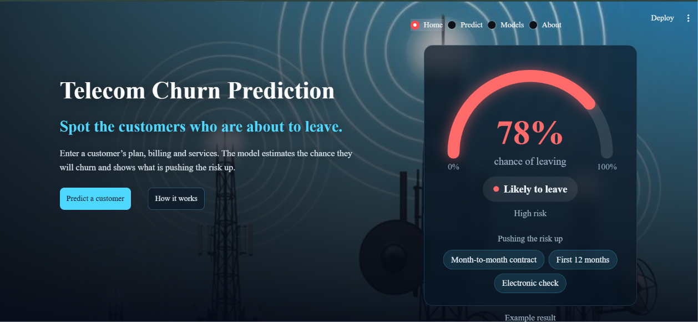
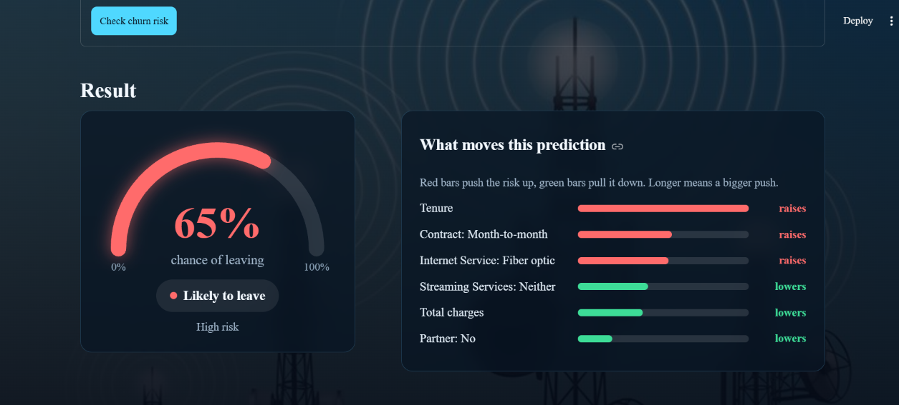

# Telecom Churn Prediction


An end-to-end machine learning project that predicts which telecom customers are likely to leave (churn). It covers exploratory data analysis, feature engineering, model comparison and a Streamlit web app that returns a churn probability for a new customer and shows what is pushing the risk up or down.



## Table of contents

- [Overview](#overview)
- [Key findings](#key-findings)
- [Model results](#model-results)
- [The app](#the-app)
- [Methodology](#methodology)
- [Project structure](#project-structure)
- [Getting started](#getting-started)
- [Limitations and next steps](#limitations-and-next-steps)
- [Author](#author)

## Overview

Customer churn means a customer stops using a company's service. Keeping an existing customer is usually cheaper than winning a new one, so knowing who is likely to leave helps a company decide where to spend its retention budget.

This project uses the **Telco Customer Churn** dataset (7,043 customers, originally a sample dataset published by IBM and widely available on Kaggle). Of these customers, 1,869 (26.5%) churned.

## Key findings

The exploratory analysis answered more than 20 questions about churn across contract type, tenure, services, billing and demographics. The strongest patterns:

| Factor | Higher-churn group | Lower-churn group |
|---|---|---|
| Contract | Month-to-month: 42.7% | Two-year: 2.8% |
| Tenure | First 12 months: 47.4% | 61–72 months: 6.6% |
| Payment method | Electronic check: 45.3% | Credit card (automatic): 15.2% |
| Internet service | Fiber optic: 41.9% | DSL: 19.0% |
| Online Security | No: 41.8% | Yes: 14.6% |
| Age group | Senior citizens: 41.7% | Non-senior: 23.6% |

Churn falls steadily the longer a customer stays. These patterns show association, not proven cause.

## Model results

Four models were compared: SVM, Random Forest, Naive Bayes and Logistic Regression (shown in two versions, original and tuned with `GridSearchCV`). They were trained on 80% of the customers and evaluated on a held-out 20% (1,409 customers, of whom 373 churned).

| Model | Accuracy | Precision | Recall | F1 score |
|---|---|---|---|---|
| SVM (tuned) | 0.806 | 0.649 | 0.579 | 0.612 |
| Random Forest (tuned) | 0.812 | 0.691 | 0.523 | 0.595 |
| Naive Bayes | 0.714 | 0.480 | 0.840 | 0.610 |
| **Logistic Regression (original)** | **0.822** | 0.688 | 0.598 | **0.640** |
| Logistic Regression (tuned) | 0.750 | 0.517 | 0.834 | 0.639 |

**Logistic Regression (original)** is used in the app because it gave the best balance of precision and recall.

Confusion matrices on the test set show the trade-off between the two Logistic Regression versions:

| Version | Churners caught | Churners missed | False alarms |
|---|---|---|---|
| Original | 223 | 150 | 101 |
| Tuned | 311 | 62 | 290 |

The two versions are tied on F1. Use the original when retention offers are costly, and the tuned version when losing a customer costs more than a wasted offer.

## The app

The Streamlit app has four pages:

- **Home:** project introduction, headline numbers and an example result.
- **Predict:** a form for the customer's profile, account and services. It returns the churn probability on a gauge, a likely-to-stay or likely-to-leave verdict, and a chart of the factors that raise or lower the risk for that customer.
- **Models:** side-by-side comparison of all models with charts and confusion matrices.
- **About:** the dataset, churn patterns and how the project was built.



## Methodology

1. **Data cleaning:** converted `TotalCharges` to numeric and handled the 11 customers with zero tenure.
2. **Exploratory analysis:** analysed churn by contract, tenure, internet service, add-on services, billing, payment method and demographics.
3. **Feature engineering:** created `AdditionalServicesCount` (number of add-on services a customer has) and `StreamingServices` (Both, TV only, Movie only or Neither).
4. **Preprocessing:** encoded categorical features and scaled numeric features inside a scikit-learn `Pipeline`, so the same steps are applied to new customers in the app.
5. **Modelling:** trained Random Forest, Naive Bayes, SVM and Logistic Regression, and tuned them with `GridSearchCV`.
6. **Evaluation:** compared accuracy, precision, recall, F1 score and confusion matrices on the held-out test set.

## Project structure

```
telecom-churn-prediction/
├── app.py                  # Streamlit app
├── bg.jpg                  # Background image
├── churn_model.pkl         # Trained Logistic Regression pipeline
├── Customer_churn.ipynb    # EDA, feature engineering and modelling
├── requirements.txt
├── .streamlit/
│   └── config.toml         # Dark theme
└── screenshots/            # Images used in this README
```

## Getting started

**1. Clone the repository**

```bash
git clone https://github.com/Anamta234/telecom-churn-prediction.git
cd telecom-churn-prediction
```

**2. Install the requirements**

```bash
pip install -r requirements.txt
```

**3. Run the app**

```bash
python -m streamlit run app.py
```

The app opens in your browser at `http://localhost:8501`.

**Note on the model file.** `churn_model.pkl` is a pickled scikit-learn pipeline, so it should be loaded with the same scikit-learn version used to train it (check with `pip show scikit-learn`). To rebuild it, run the notebook and then:

```python
import joblib
joblib.dump(pipe_4, "churn_model.pkl")
```

## Limitations and next steps

- Results come from a single dataset and one train/test split, so cross-validation would add confidence.
- Predictions use the default 0.5 decision threshold. Tuning the threshold for a chosen retention budget could improve results.
- The patterns found are statistical associations, not proven causes of churn.
- Possible extensions: model explainability with SHAP, probability calibration, and deploying the app on Streamlit Community Cloud.

## Author

**Anamta Saleem**

- GitHub: [github.com/Anamta234](https://github.com/Anamta234)
- LinkedIn: [linkedin.com/in/anamta-saleem-29a481360](https://linkedin.com/in/anamta-saleem-29a481360)
